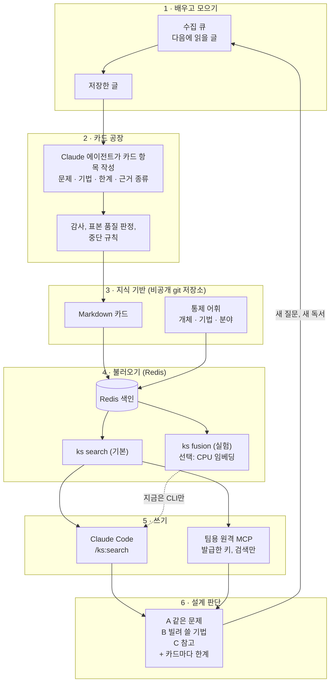
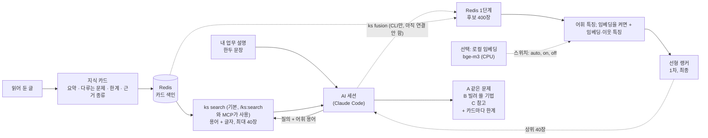

[English](README.md) | 한국어

# knowledge-scout

<!-- s:vision -->
> **읽은 글을 맥락과 기술의 연결로 찾아 쓰는 지식 기반으로 바꿉니다. 지난 독서가 다음 설계의 재료가 됩니다.**

knowledge-scout는 Redis 위에 만든 개인·소규모 팀용 지식 검색 시스템입니다. 저장한 기술 글은 한 편마다 정해진 구조의 **지식 카드**가 됩니다. 카드에는 그 글이 다루는 문제, 쓰는 기법, 한계, 근거의 종류가 들어갑니다. 무언가를 설계하기 시작할 때 할 일을 한두 문장으로 적으면 Redis가 맞는 카드를 불러옵니다. 그다음은 AI 세션(Claude Code)이 같이 생각하는 상대가 됩니다. 카드를 **A** 같은 문제, **B** 빌려 쓸 기법, **C** 참고로 나누고, 카드마다 **한계**를 옆에 보여 줍니다.

엔진(이 저장소)은 공개합니다. 카드와 원문은 각자의 비공개 저장소에 둡니다.

<!-- s:story -->
## 왜 만들었나

저는 기술 글을 많이 읽습니다. 그런데 중요한 글일수록 정작 필요할 때 떠오르지 않습니다. 다음 시스템을 설계하려고 앉은 바로 그때입니다. 이 문제를 다룬 글을 읽었다는 기억은 남습니다. 무슨 내용이었는지, 어디 있었는지는 남지 않습니다.

AI 에이전트가 맥락을 어떻게 유지하는지 공부하다가 이것이 같은 문제라는 걸 알았습니다. 모델은 지금 컨텍스트 창에 있는 것만으로 답합니다. 창 밖에 있는 것은 없는 것과 같습니다. Ilyas Ibrahim은 Claude Code 시리즈에서 이를 "컨텍스트 건망증(context amnesia)"이라고 부릅니다.

Redis 글 한 편과 이 3부작 시리즈를 직접 공부했습니다. 어느 글도 지식 검색 시스템을 다루지 않습니다. 제가 가져온 것은 원리였고, 그 원리를 다른 문제에 옮겼습니다.

| 읽은 아이디어 | 출처 | 여기서 된 것 |
| --- | --- | --- |
| 메모리는 아키텍처 요구사항이다. 빠른 공유 저장소로 밖에 꺼내 둔다 | Redis 글 | 카드는 세션 밖에 있고 Redis에 색인된다 |
| Redis는 기억하는 층이지 생각하는 층이 아니다 | Redis 글 | 불러오기는 Redis, A·B·C 판정은 AI 세션 |
| 보고서를 다 읽지 말고 짧은 레지스트리를 읽는다 | Ilyas 2부 | 검색은 원문이 아니라 한 장짜리 카드를 읽는다 |
| 필요한 맥락만 골라 넣어 준다 | Ilyas 2부 | 세션은 돌려받은 후보(최대 40장)만 본다 |
| "끝냈다"는 말을 믿지 말고 결과를 확인한다 | Ilyas 2부 | 카드 생성 실행을 감사하고 표본을 판정한다. 검색 품질은 측정한다 |
| 기준을 글로 적어 워크플로에 넣는다 | Ilyas 3부 | 고정된 카드 스키마와 통제 어휘 |

제가 한 일은 에이전트의 맥락을 지켜 주는 이 원리를 사람과 AI가 함께 설계하는 과정 자체에 옮긴 것입니다. 글은 모두 같은 항목을 가진 카드가 됩니다. 카드끼리는 개체·기법·분야의 통제 어휘로 이어집니다. 그래서 배치 작업의 메모리 증가를 다룬 글이, 기법이 같다는 이유로 로그 분석 업무에서 떠오를 수 있습니다. 불러오는 일은 Redis가 합니다. 생각하는 일은 AI 세션이 합니다. 돌려받은 카드만 읽고 A, B, C로 나누며, 카드에 적힌 한계를 계속 옆에 둡니다.

**영감을 준 글**(코드가 아니라 아이디어입니다. 이 시스템은 제가 직접 엮어 만든 것입니다):
- [Redis as Agent Memory: Building Stateful AI Agents with Redis and LangChain](https://medium.com/gitconnected/redis-as-agent-memory-building-stateful-ai-agents-with-redis-and-langchain-3dcd191a4fc2): 에이전트 메모리를 밖으로 꺼내 공유하고, Redis를 기억하는 층으로 쓰는 법.
- Ilyas Ibrahim, [How I Made Claude Code Agents Coordinate 100% and Solved Context Amnesia](https://medium.com/@ilyas.ibrahim/how-i-made-claude-code-agents-coordinate-100-and-solved-context-amnesia-5938890ea825): 컨텍스트 건망증을 실제로 겪은 기록. 에이전트들이 서로의 작업을 되풀이하던 일을, 공유 레지스트리를 가진 메인 에이전트가 조율해 멈춘 과정.
- Ilyas Ibrahim, [The 4-Step Protocol That Fixes Claude Code Agent's Context Amnesia](https://medium.com/@ilyas.ibrahim/the-4-step-protocol-that-fixes-claude-codes-context-amnesia-c3937385561c): 레지스트리, 맥락 주입, 순서 결정, 검증 게이트.
- Ilyas Ibrahim, [How to Build Production-Grade Systems with Claude Code without Context Drift](https://medium.com/@ilyas.ibrahim/how-to-build-production-grade-systems-with-claude-code-87f73dd311b9): 리뷰 체인, 그리고 글로 적어 워크플로에 넣은 기준.

<!-- s:overview -->
## 전체 그림

읽은 글은 카드가 되고, 카드는 검색으로 다시 불려 나오고, 불려 나온 카드는 설계 판단에 쓰입니다. 설계를 하다 보면 다음에 읽을 질문이 생깁니다.



<!-- s:achieved -->
## 지금까지 이룬 것

- **매일 씁니다.** 비공개 코퍼스(저장한 기술 글 약 19,600편)로 매일 쓰고 있습니다. 수치의 바탕이 된 카드는 공개하지 않습니다. 지금 배포되는 것은 `ks search`(Redis, 어휘 용어와 글자 일치, 모델 없음), Claude Code plugin(`/ks:search`, `/ks:add`), API 키를 쓰는 검색 전용 원격 MCP 서버입니다.
- **짐작하지 않고 쟀습니다.** 고정한 카드 5,607장 스냅샷, 실사용 질의 100개, Claude Sonnet 판정자가 등급을 매긴 (질의, 카드) 쌍 40,907건을 씁니다. Claude Opus 판정자와의 일치도는 교차 판정 표본에서 가중 kappa 0.903입니다. 질의의 test 절반은 봉인해 두었습니다.
- **정밀도@10이 0.298에서 0.744, 0.796으로 올랐습니다**(질의만, dev 절반 기준 out-of-fold). 차례로 이전 `ks search` 엔진, CPU만 쓰는 실험 랭커 `ks fusion`, 여기에 선택 CPU 임베딩을 더한 결과입니다. 질의 + 어휘 용어로는 0.568, 0.794, 0.808입니다.
- **모자란 점도 적습니다.** 출시 기준은 두 모드 모두 0.80입니다. 질의만 쓰는 모드는 기준에 조금 못 미치고(0.796), 봉인한 테스트는 아직 돌리지 않았습니다. fusion은 CLI에서만 쓸 수 있고 `ks search`와 `ks mcp serve`에는 아직 연결하지 않았습니다.
- **가볍게 돕니다.** Redis와 CPU만 있으면 됩니다. GPU도 벡터 DB도 없습니다. CPU만 쓰면 p50 약 15 ms, 실제 CPU 임베딩을 쓰면 실험실 하네스에서 p50 약 190 ms입니다([docs/FUSION.md](docs/FUSION.md), 영문).
- **엔진 일치.** Rust 랭커는 JS 기준 구현과 상위 40개의 id와 점수가 100% 같고, 워크스페이스 테스트 361개가 통과합니다(커밋 a7cb2ab, `scripts/ks-redis-test.sh`).

<!-- s:example -->
## 예시

업무: "웹 서버 로그에서 느린 요청을 찾아 원인 후보를 좁히고 싶다". 아래 카드는 지어낸 것입니다.

| 카드 | 걸린 이유 | 등급 |
| --- | --- | --- |
| "로그만으로는 느린 요청의 원인을 좁히기 어렵다" | 업무와 같은 문제 | A |
| "배치 작업 중 메모리가 계속 늘어난다"(기법: `request-id` 기반 추적) | 문제는 다르지만 기법을 가져올 수 있음 | B |
| "로그 저장 비용이 빠르게 늘어난다" | 같은 분야(로그). 문제도 기법도 겹치지 않음 | C |
| 화면 전환 애니메이션 글. 본문에 "느린"이라는 말이 있음 | 단어만 겹침 | 제외 |

A 카드의 한계가 "단일 서버를 전제한다"라면, 그 문장을 적힌 그대로 보여 주고 내 환경에 맞는지는 사람이 판단합니다. 한계 때문에 카드의 등급을 올리거나 내리지 않습니다.

<!-- s:diagram -->
## 검색 경로 자세히



<!-- s:how -->
## 지금 검색은 이렇게 동작합니다

같은 카드를 놓고 랭커가 둘 있습니다.

| | `ks search` (기본) | `ks fusion` (두 번째 랭커, 데모 단계) |
| --- | --- | --- |
| 쓰는 곳 | `/ks:search`, `ks mcp serve`(stdio와 원격) | CLI만: `ks fusion build`, `search`, `batch` |
| 후보 | Redis에서 일치한 어휘 용어와 글자, 최대 40장 | Redis 가중 전문 검색 1단계, 상위 400장 |
| 순위 | 일치 수를 셀 뿐 판정하지 않음 | 계산하는 특징 88개, 선형 랭커 둘, 상위 40장 |
| 임베딩 | 없음 | 선택, 로컬, CPU |

`ks fusion`의 동작은 이렇습니다.

1. **색인**: `ks fusion build`가 카드 한 장을 Redis 해시 하나로 씁니다. 전용 키 접두사(`ksf:`) 아래에 둡니다. 카드의 임베딩 벡터는 FLOAT16 해시 필드이고 벡터 색인이 아닙니다. 원본은 카드 파일이므로 색인은 언제든 다시 만들 수 있습니다.
2. **1단계**: 가중 `FT.SEARCH` 한 번으로 상위 400장을 가져옵니다.
3. **특징**: 스키마는 JS 기준 구현과 공유하는 142개 열입니다. 이 엔진은 그중 88개를 계산하고, 다른 열을 읽는 모델은 거부합니다. 어휘 특징이 83개입니다(질의 용어와 제목·키워드·요약·다루는 문제·한계 필드의 일치, 커버리지, n-gram). 나머지 5개는 임베딩이 있어야 하고 그 경로에만 있습니다. 3개는 질의와 카드를 비교하고(코사인, 그 z-점수, 역순위), 2개는 후보끼리의 임베딩 이웃 신호입니다.
4. **랭커**: 1차 선형 랭커 다음에 최종 선형 랭커가 있습니다. 경로(임베딩 끔과 켬)마다, 모드(질의만, 질의 + 어휘 용어)마다 한 벌씩 있습니다. 학습된 가중치 파일은 이 저장소에 없고 `--model`로 넘깁니다.
5. **임베딩 스위치**: `--switch auto|on|off`. `auto`는 Redis가 답하는 동안 로컬 llama.cpp 서버에서 질의를 임베딩합니다. 서버가 700 ms를 넘기거나 실패하면 그 질의는 CPU 경로만으로 순위를 매기고 5초 차단기가 열립니다. 후보(또는 카드)의 80% 미만에만 벡터가 있을 때도 임베딩 없이 순위를 매깁니다(`few-vectors`, `no-vectors`). 어느 `path`를 탔는지와 이유(`reason`)는 JSON에 적힙니다.
6. **판정**: AI 세션이 돌려받은 카드만 읽고 A, B, C, 제외로 나누며, 카드마다 한계를 같이 보여 줍니다. 카드 본문은 외부 글에서 왔으므로 지시가 아니라 데이터로만 다룹니다.

<!-- s:quality -->
## 검색 품질과 측정 방법

정밀도@10은 상위 10장 중 판정자가 관련 있다고 본 카드의 비율입니다. 0~2 등급에서 1(일부 도움) 또는 2(바로 답함)를 관련으로 셉니다. 판정이 없는 카드는 관련 없음으로 세므로 수치는 하한입니다. 비공개 검색 실험실의 dev 절반 기준 out-of-fold 수치입니다.

| 랭커 | 질의만 | 질의 + 용어 |
| --- | --- | --- |
| 이전 `ks search` 엔진 | 0.298 | 0.568 |
| 글자 n-gram BM25 | 0.508 | 0.684 |
| bge-m3 임베딩 단독 | 0.636 | 0.686 |
| `ks fusion`, CPU만(`--switch off`) | 0.744 | 0.794 |
| `ks fusion` + CPU 임베딩(`--switch on`) | 0.796 | 0.808 |
| 출시 기준 | 0.80 | 0.80 |

임베딩 행은 실제 임베딩을 쓴 실행입니다(0.796. 캐시한 질의 벡터를 쓰면 0.802, [docs/FUSION.md](docs/FUSION.md) 참고). 배포용 가중치는 dev 질의로 맞췄습니다. 그래서 이 표는 처음 보는 데이터가 아니라 dev 절반 기준 out-of-fold 값입니다.

**방법.** 고정한 카드 5,607장 스냅샷을 씁니다. 실사용 질의 100개(한국어 80, 영어 20)에 골든 질의와 새 질의 세트를 더했습니다. (질의, 카드) 쌍 40,907건은 Claude Sonnet 판정자가 등급을 매겼고, Claude Opus 판정자와의 일치도는 가중 kappa 0.903이고, Opus가 교차 판정한 61개 패킷 표본에서 쟀습니다. 질의는 dev와 test 절반으로 나누고 test 절반은 봉인했습니다. out-of-fold는 각 질의를 그 질의 없이 맞춘 모델로 채점한다는 뜻입니다.

**현재 상태.** 기준은 두 모드 모두 0.80입니다. 임베딩을 쓰면 질의 + 용어는 기준을 넘고(0.808), 질의만은 조금 못 미칩니다(0.796). CPU만 쓰면 두 모드 모두 기준 아래입니다. 봉인한 테스트는 아직 돌리지 않았습니다. 그래서 이 값은 최종 결과가 아니라 dev 수치입니다.

**한계.** 판정자는 LLM입니다. 실험실 세트, 판정, 학습된 가중치는 비공개라서 이 저장소만으로는 표를 재현할 수 없습니다. 수치는 코퍼스 하나와 질의 구성 하나에서 나온 것입니다. 지연은 CPU만 쓰면 p50 약 15 ms, 실제 CPU 임베딩을 쓰면 실험실 하네스에서 p50 약 190 ms([docs/FUSION.md](docs/FUSION.md), 영문)이고, 조용한 MacBook에서 따뜻한 질의 1건은 약 50 ms였습니다. Rust 랭커는 dev 질의 112개 형태 x 2개 모드 x 2개 경로 모두에서 JS 기준 구현과 상위 40개의 id와 점수가 같습니다.

<!-- s:demo -->
## 데모

`ks search`는 아래 빠른 시작의 공개 샘플로 돌려 볼 수 있습니다. `ks fusion` 데모는 실험실의 모델 파일과 별칭 사전도 필요한데 공개하지 않으므로, 이 절은 읽는 데모로 봐 주세요.

```
cargo build --release
export KS_REDIS_URL=...    # ks가 쓰는 Redis. 값은 출력하지 않습니다
# 1. fusion 색인 만들기 (전용 접두사 ksf:, 일반 ks 키는 건드리지 않음)
ks fusion build --data <데이터 디렉터리> --aliases <aliases.json> --model <fusion-model.json> \
    --vectors <card-vectors.bin> --prefix ksf:
# 2. 검색: --switch off는 CPU만, auto는 로컬 bge-m3 서버가 답하면 임베딩 사용
ks fusion search --query "GitHub Actions에서 APK 빌드와 서명 자동화" --limit 3 \
    --switch auto --embed-url http://127.0.0.1:<port>
# 또는: 색인을 만든 뒤 질의 5개를 --switch off와 --switch auto로 각각 실행
bash scripts/fusion-demo.sh <데이터 디렉터리> <aliases.json> <fusion-model.json> [<vectors.bin>] [<긴 요약 디렉터리>]
```

`<데이터 디렉터리>`는 `cards/`와 `vocab/`이 들어 있는 데이터 루트입니다. 출력 모양입니다(줄여 적음). 숫자는 예시이고 제목은 지어낸 것입니다. 서버가 꺼졌거나 너무 느리면 같은 호출이 `"path": "off"`, `"reason": "embed-timeout"`(또는 `"embed-error"`)과 함께 CPU만 쓴 순위를 돌려줍니다.

```json
{ "switch": "auto", "path": "on", "reason": "embedded", "candidates": 400,
  "ms": { "embed": 33, "total": 52 },
  "results": [
    { "rank": 1, "title": "CI에서 키스토어를 노출하지 않고 안드로이드 릴리스 빌드 서명하기" },
    { "rank": 2, "title": "GitHub Actions에서 Gradle 의존성 캐시하기" },
    { "rank": 3, "title": "파이프라인에서 Play 스토어 업로드 자동화하기" } ] }
```

<!-- s:fit -->
## 맞는 곳과 안 맞는 곳

이런 곳에 맞습니다.
- 개인이나 작은 팀이 글 수백~수천 편을 모아 두고, 일을 시작하기 전에 선행 사례를 찾을 때
- Claude Code 같은 AI 코딩 도구 안에서 바로 쓰고 싶을 때
- GPU나 별도 검색 서비스 없이 Redis와 CPU만으로 돌리고 싶을 때. 임베딩은 선택입니다.

이런 곳에서는 맞지 않거나 한계가 있습니다.
- **카드가 없는 글은 찾지 못합니다.** 카드에 적지 않은 세부도 찾지 못합니다.
- **기본 엔진은 쓰는 말이 다르면 놓칩니다.** `ks search` 자체 평가에서 기대한 카드 59건 중 47건(79.7%)이 후보 40장 안에 들었습니다. 조건은 질의 50개, 비공개 평가셋, 판정자 1명이 1회 수행이므로 오차가 큽니다. 검색 용어를 어휘 목록을 보고 골랐는데 실제 스킬은 목록을 보여 주지 않으므로, 실사용 값은 더 낮을 가능성이 높고 재 본 적이 없습니다. `ks fusion`의 선택 임베딩이 이 틈을 노립니다(위 표 참고). 실험실 세트에서만 쟀습니다.
- **검색 한 번에 품이 듭니다.** AI 세션 흐름을 측정한 1회는 58초에 모델 사용료 약 0.60달러였습니다. 하루에 몇 번 쓰는 용도에 맞습니다.
- 수십만 편 이상이거나 원문을 바로 검색해야 하는 용도에는 임베딩 기반 검색(RAG)이 맞습니다. 아래 "이것은 RAG인가?"를 보세요.

<!-- s:quickstart -->
## 빠른 시작

`examples/sample-data`의 작은 공개 샘플 카드(17장, 골든 질의 10개)로 먼저 써 볼 수 있습니다. Redis를 띄운 뒤 `ks index rebuild --data examples/sample-data`로 색인하고, `ks search --data examples/sample-data --vocab examples/sample-data/vocab/terms.json --queries examples/sample-data/queries.json --out <out.json>`으로 검색합니다. 내 카드로 쓰려면 다음과 같이 합니다.

1. Redis를 띄우고 `ks`와 Claude Code plugin을 설치합니다. 절차는 [docs/ko/INSTALL.md](docs/ko/INSTALL.md)에 있습니다.
2. 카드를 비공개 디렉터리에 두고 `ks card validate --data <data>`와 `ks index rebuild --data <data>`를 실행합니다.
3. Claude Code에서 `/ks:search <내 업무>`를 실행합니다. `/ks:add <URL이나 파일>`은 글 한 편을 카드로 만듭니다.

수집 쪽은 [docs/ko/OPERATIONS.md](docs/ko/OPERATIONS.md)를 보세요.

<!-- s:rag -->
## 이것은 RAG인가?

넓은 뜻으로는 그렇습니다. 먼저 검색하고, 찾은 것을 AI가 읽습니다. 다른 점은 두 가지입니다. 원문 조각이 아니라 **카드**를 찾고, 기본 엔진은 **태그와 글자 일치**(키워드 검색)로 찾습니다. 선택 경로인 `ks fusion`은 로컬 CPU 임베딩을 순위 특징의 한 묶음으로 더합니다. 그래도 벡터 DB는 없습니다. 카드 벡터는 평범한 Redis 해시 필드이고 벡터 색인이 아닙니다.

**RAG나 벡터 DB 쪽으로 더 나아갈 신호**(기준값은 제안이며 측정한 값이 아닙니다):
- 바꿔 쓴 질의에서 점수가 눈에 띄게 낮거나, 새 질의에서 기대 카드가 후보 40장에 드는 비율이 85% 미만이다: 임베딩 경로를 씁니다(실험실에서는 질의만 쓰는 모드의 정밀도@10이 약 0.05 오릅니다).
- 카드가 없는 글이나 카드에 없는 세부를 찾아야 한다: 원문 조각을 검색합니다.
- 한국어 질문으로 영어 글을 바로 찾아야 한다: 다국어 임베딩(bge-m3가 그중 하나입니다). 글자 일치는 언어를 건너지 못합니다.
- 벡터 100만 개 이상, 또는 초당 수십 건의 질의: 전용 벡터 DB.

**백로그 공지: `FT.HYBRID`(키워드+벡터 하이브리드 검색, Redis 한 질의로)는 백로그이며 추후 제공할 예정입니다.** 지금 knowledge-scout는 벡터 색인을 쓰지 않습니다.

근거, 전체 표, 자료([BEIR](https://arxiv.org/abs/2104.08663), [Anthropic Contextual Retrieval](https://www.anthropic.com/news/contextual-retrieval), [Redis `FT.HYBRID`](https://redis.io/docs/latest/commands/ft.hybrid/) 등)는 [docs/ko/SEARCH-AND-RAG.md](docs/ko/SEARCH-AND-RAG.md)에 있습니다. 대부분 벤더 시험이거나 작은 연구입니다. 단서로 읽고, 내 질의로 직접 재 보세요.

<!-- s:remote -->
## 원격 MCP (v0.2.0)

운영자가 발급한 키로, 다른 사람이 자기 Claude Code에서 내 카드를 검색하게 합니다. 기본 `ks search` 순위를 쓰며, fusion은 아직 연결하지 않았습니다.

- **검색만 합니다.** 원격 서버는 `ks_search`와 `ks_get`만 제공합니다. 웹 검색, 기록, 수집, 카드 만들기, 색인은 운영자만 합니다.
- **키.** 운영자가 `ks key issue`로 키를 발급하고, Redis에는 키의 해시만 저장합니다. 역할은 `reader`(공개 카드와 정해진 필드만), `admin`과 `owner`(카드 전체)입니다.
- **기본은 닫혀 있습니다.** 유효한 키 없이는 loopback이 아닌 주소에서 서버가 열리지 않고, Host와 Origin을 검사합니다.
- **연결.** SSH 터널을 연 뒤, `http://127.0.0.1:8790/mcp`에 `Authorization: Bearer <키>` 헤더로 HTTP MCP 서버를 추가합니다.

자세한 내용은 [docs/ko/REMOTE-MCP.md](docs/ko/REMOTE-MCP.md)에 있습니다.

<!-- s:status -->
## 상태

v0.2.0 릴리스 후보는 macOS에서 Redis, `ks` CLI, Claude Code plugin으로 동작합니다. Linux는 CI 시험은 통과하지만 실사용은 확인하지 못했고, Windows는 지원하지 않습니다. 수집 큐, HTTP 원격 MCP(검색만, API 키), 샘플 풀은 들어 있고 `ks export --scope team`은 아직 없습니다. `ks fusion`은 데모 단계이고("지금까지 이룬 것" 참고), `FT.HYBRID`는 백로그입니다. [CHANGELOG.md](CHANGELOG.md)(영문)를 보세요.

<!-- s:google -->
## Google 브라우저 수집 주의

`google-browser` 엔진은 사용자 본인의 로그인 프로필로 Google 검색 결과 페이지를 자동으로 조회합니다. 이런 자동 조회는 Google 약관에 저촉될 위험이 있고, 그 위험은 사용하는 사람이 판단하고 감수해야 합니다. 기본값은 낮은 빈도(질의 사이 3~8초 간격, 프로필별 시간당 20회·하루 100회 쿼터), 그리고 사람 개입 우선(CAPTCHA·동의·차단이 나오면 멈춤)입니다. 탐지 회피는 하지 않습니다.

Google 서비스 약관은 robots.txt를 따르지 않는 자동화 접근을 금지하고, google.com의 robots.txt는 `/search`를 허용하지 않습니다. 이 엔진을 쓰는 것은 그 약관을 어길 수 있으며, 위반이 중대하거나 반복되면 Google이 계정을 정지할 수 있습니다. 평소 쓰는 계정 대신 이 용도 전용 Google 계정을 쓰기를 권합니다. 약관을 지키는 대안은 공식 API 어댑터(계획)입니다.

<!-- s:docs -->
## 문서 지도와 라이선스

- [docs/ko/INSTALL.md](docs/ko/INSTALL.md): Redis, `ks`, 카드 디렉터리, plugin, 스킬, Google 로그인
- [docs/ko/OPERATIONS.md](docs/ko/OPERATIONS.md): 수집 큐, 아키텍처 그림, 브라우저 검색 흐름, 구성 요소, 데이터 흐름
- [docs/ko/SEARCH-AND-RAG.md](docs/ko/SEARCH-AND-RAG.md): 검색 방식, 한계, RAG로 넘어갈 때
- [docs/FUSION.md](docs/FUSION.md)(영문): fusion 랭커(`ks fusion`)의 명령, 임베딩 스위치, 안전 규칙, 측정
- [docs/ko/REMOTE-MCP.md](docs/ko/REMOTE-MCP.md): 원격 MCP (v0.2.0)
- [docs/ko/SECURITY.md](docs/ko/SECURITY.md), [ARCHITECTURE.md](ARCHITECTURE.md)(영문), [CHANGELOG.md](CHANGELOG.md)(영문)

라이선스는 Apache-2.0입니다([LICENSE](LICENSE)). 빌려 온 코드의 출처는 [NOTICE](NOTICE)에 적어 두었습니다.
