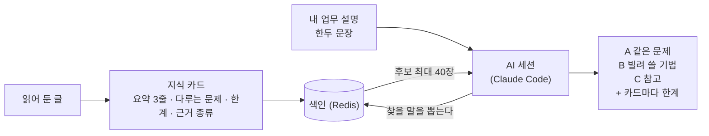

[English](README.md) | 한국어

# knowledge-scout

읽어 둔 기술 글을, 새 일을 시작할 때 다시 꺼내 쓰게 해 주는 도구입니다.

"비슷한 문제를 다룬 글을 분명히 읽었는데" 하고 떠올려도 다시 찾기는 어렵습니다. knowledge-scout는 글을 한 장짜리 **지식 카드**로 줄여 둡니다. 지금 하려는 일을 한두 문장으로 말하면 맞는 카드를 골라 줍니다. **A**는 같은 문제를 다룬 글, **B**는 기법을 빌려 쓸 수 있는 글, **C**는 참고할 글입니다. 카드마다 그 글의 **한계**를 같이 보여 줍니다.

엔진(이 저장소)은 공개합니다. 카드와 원문은 각자의 비공개 저장소에 둡니다. 판정은 Claude Code 같은, 이미 쓰고 있는 AI 세션이 합니다.

<!-- s:example -->
## 예시

업무: "웹 서버 로그에서 느린 요청을 찾아 원인 후보를 좁히고 싶다". 아래 카드는 지어낸 것입니다.

| 카드 | 걸린 이유 | 등급 |
| --- | --- | --- |
| "로그만으로는 느린 요청의 원인을 좁히기 어렵다" | 업무와 같은 문제 | A |
| "배치 작업 중 메모리가 계속 늘어난다"(기법: `request-id` 기반 추적) | 문제는 다르지만 기법을 가져올 수 있음 | B |
| "로그 저장 비용이 빠르게 늘어난다" | 같은 분야(로그). 문제도 기법도 겹치지 않음 | C |
| 화면 전환 애니메이션 글. 본문에 "느린"이라는 말이 있음 | 단어만 겹침 | 제외 |

A 카드의 한계가 "단일 서버를 전제한다"라면, 그 문장을 적힌 그대로 보여 주고 내 환경에 맞는지는 사람이 판단합니다. 한계 때문에 카드의 등급을 올리거나 내리지 않습니다.

<!-- s:diagram -->
## 그림

<!-- s:why -->
## 왜 필요한가

- 저장만 해 둔 글은 필요할 때 찾지 못합니다.
- 일반 검색은 "비슷한 글"을 줄 뿐, 내 일에 쓸 수 있는지는 말해 주지 않습니다.
- 글마다 근거의 무게가 다릅니다. 측정한 글인지, 경험담인지, 의견인지를 같이 봐야 합니다.

<!-- s:fit -->
## 맞는 곳과 안 맞는 곳

이런 곳에 맞습니다.
- 개인이나 작은 팀이 글 수백~수천 편을 모아 두고, 일을 시작하기 전에 선행 사례를 찾을 때
- Claude Code 같은 AI 코딩 도구 안에서 바로 쓰고 싶을 때
- 임베딩 모델이나 별도 검색 서비스 없이 돌리고 싶을 때

이런 곳에서는 맞지 않거나 한계가 있습니다.
- **카드가 없는 글은 찾지 못합니다.** 카드에 적지 않은 세부도 찾지 못합니다.
- **쓰는 말이 다르면 놓칩니다.** 자체 평가에서 기대한 카드 59건 중 47건(79.7%)이 후보 40장 안에 들었습니다. 조건은 질의 50개, 비공개 평가셋, 판정자 1명이 1회 수행이므로 오차가 큽니다. 검색 용어를 어휘 목록을 보고 골랐는데 실제 스킬은 목록을 보여 주지 않으므로, 실사용 값은 더 낮을 가능성이 높고 재 본 적이 없습니다.
- **검색 한 번에 품이 듭니다.** 측정한 1회는 58초에 모델 사용료 약 0.60달러였습니다. 하루에 몇 번 쓰는 용도에 맞습니다.
- 수십만 편 이상이거나 원문을 바로 검색해야 하는 용도에는 임베딩 기반 검색(RAG)이 맞습니다. 아래 "이것은 RAG인가?"를 보세요.

<!-- s:quickstart -->
## 빠른 시작

`examples/sample-data`의 작은 공개 샘플 카드(17장, 골든 질의 10개)로 먼저 써 볼 수 있습니다. Redis를 띄운 뒤 `ks index rebuild --data examples/sample-data`로 색인하고, `ks search --data examples/sample-data --vocab examples/sample-data/vocab/terms.json --queries examples/sample-data/queries.json --out <out.json>`으로 검색합니다. 내 카드로 쓰려면 다음과 같이 합니다.

1. Redis를 띄우고 `ks`와 Claude Code plugin을 설치합니다. 절차는 [docs/ko/INSTALL.md](docs/ko/INSTALL.md)에 있습니다.
2. 카드를 비공개 디렉터리에 두고 `ks card validate --data <data>`와 `ks index rebuild --data <data>`를 실행합니다.
3. Claude Code에서 `/ks:search <내 업무>`를 실행합니다. `/ks:add <URL이나 파일>`은 글 한 편을 카드로 만듭니다.

수집 쪽은 [docs/ko/OPERATIONS.md](docs/ko/OPERATIONS.md)를 보세요.

<!-- s:how -->
## 동작 원리

1. **카드**: 글 한 편이 Markdown 파일 하나가 됩니다(요약, 다루는 문제, 한계, 근거 종류, 통제 어휘 태그).
2. **색인**: `ks index rebuild`가 모든 카드를 Redis에 올립니다. 원본은 카드 파일이므로 색인은 언제든 다시 만들 수 있습니다.
3. **질의**: AI 세션이 내 업무를 어휘 용어와 짧은 문제 문구로 바꿉니다.
4. **후보**: 엔진이 일치한 용어와 글자로 카드를 줄 세워 최대 40장을 돌려줍니다. 세기만 하고 판정하지는 않습니다.
5. **판정**: 세션이 카드만 읽고 A, B, C, 제외로 나누며, 카드마다 한계를 같이 보여 줍니다. 카드 본문은 외부 글에서 왔으므로 지시가 아니라 데이터로만 다룹니다.

<!-- s:rag -->
## 이것은 RAG인가?

넓은 뜻으로는 그렇습니다. 먼저 검색하고, 찾은 것을 AI가 읽습니다. 다른 점은 두 가지입니다. 원문 조각이 아니라 **카드**를 찾고, **태그와 글자 일치**(키워드 검색)로 찾습니다. 임베딩도 벡터 DB도 없습니다.

**잘 맞는 조건:** 카드가 수백~수천 장이고, 질의에 기술 이름이 들어가고, 결과가 왜 걸렸는지 설명해야 하고, 서버에서 모델을 돌리고 싶지 않을 때입니다.

**RAG나 벡터 DB로 넘어갈 신호**(기준값은 제안이며 측정한 값이 아닙니다):
- 바꿔 쓴 질의에서 점수가 눈에 띄게 낮거나, 새 질의에서 기대 카드가 후보 40장에 드는 비율이 85% 미만이다: 카드 글을 임베딩해 같은 Redis에 넣습니다.
- 카드가 없는 글이나 카드에 없는 세부를 찾아야 한다: 원문 조각을 검색합니다.
- 한국어 질문으로 영어 글을 바로 찾아야 한다: 다국어 임베딩. 글자 일치는 언어를 건너지 못합니다.
- 벡터 100만 개 이상, 또는 초당 수십 건의 질의: 전용 벡터 DB.

**백로그 공지: `FT.HYBRID`(키워드+벡터 하이브리드 검색, Redis 한 질의로)는 백로그이며 추후 제공할 예정입니다.** 지금 knowledge-scout는 벡터 검색을 쓰지 않습니다.

근거와 전체 표는 [docs/ko/SEARCH-AND-RAG.md](docs/ko/SEARCH-AND-RAG.md)에 있습니다. 주요 자료:
[BEIR](https://arxiv.org/abs/2104.08663),
[Anthropic Contextual Retrieval](https://www.anthropic.com/news/contextual-retrieval),
[Li 외 2024](https://arxiv.org/abs/2407.16833),
[LaRA](https://arxiv.org/abs/2502.09977),
[Redis 벡터](https://redis.io/docs/latest/develop/ai/search-and-query/vectors/),
[Redis `FT.HYBRID`](https://redis.io/docs/latest/commands/ft.hybrid/),
[Redis 어간 처리](https://redis.io/docs/latest/develop/ai/search-and-query/advanced-concepts/stemming/).
대부분 벤더 시험이거나 작은 연구입니다. 단서로 읽고, 내 질의로 직접 재 보세요.

<!-- s:remote -->
## 원격 MCP (v0.2.0)

운영자가 발급한 키로, 다른 사람이 자기 Claude Code에서 내 카드를 검색하게 합니다.

- **검색만 합니다.** 원격 서버는 `ks_search`와 `ks_get`만 제공합니다. 웹 검색, 기록, 수집, 카드 만들기, 색인은 운영자만 합니다.
- **키.** 운영자가 `ks key issue`로 키를 발급하고, Redis에는 키의 해시만 저장합니다. 역할은 `reader`(공개 카드와 정해진 필드만), `admin`과 `owner`(카드 전체)입니다.
- **기본은 닫혀 있습니다.** 유효한 키 없이는 loopback이 아닌 주소에서 서버가 열리지 않고, Host와 Origin을 검사합니다.
- **연결.** SSH 터널을 연 뒤, `http://127.0.0.1:8790/mcp`에 `Authorization: Bearer <키>` 헤더로 HTTP MCP 서버를 추가합니다.

자세한 내용은 [docs/ko/REMOTE-MCP.md](docs/ko/REMOTE-MCP.md)에 있습니다.

<!-- s:status -->
## 상태

v0.2.0 릴리스 후보는 macOS에서 Redis, `ks` CLI, Claude Code plugin으로 동작합니다. Linux는 CI 시험은 통과하지만 실사용은 확인하지 못했고, Windows는 지원하지 않습니다. 수집 큐, HTTP 원격 MCP(검색만, API 키), 샘플 풀은 들어 있고 `ks export --scope team`은 아직 없습니다. [CHANGELOG.md](CHANGELOG.md)(영문)를 보세요.

<!-- s:google -->
## Google 브라우저 수집 주의

`google-browser` 엔진은 사용자 본인의 로그인 프로필로 Google 검색 결과 페이지를 자동으로 조회합니다. 이런 자동 조회는 Google 약관에 저촉될 위험이 있고, 그 위험은 사용하는 사람이 판단하고 감수해야 합니다. 기본값은 낮은 빈도(질의 사이 3~8초 간격, 프로필별 시간당 20회·하루 100회 쿼터), 그리고 사람 개입 우선(CAPTCHA·동의·차단이 나오면 멈춤)입니다. 탐지 회피는 하지 않습니다.

Google 서비스 약관은 robots.txt를 따르지 않는 자동화 접근을 금지하고, google.com의 robots.txt는 `/search`를 허용하지 않습니다. 이 엔진을 쓰는 것은 그 약관을 어길 수 있으며, 위반이 중대하거나 반복되면 Google이 계정을 정지할 수 있습니다. 평소 쓰는 계정 대신 이 용도 전용 Google 계정을 쓰기를 권합니다. 약관을 지키는 대안은 공식 API 어댑터(계획)입니다.

<!-- s:docs -->
## 문서 지도와 라이선스

- [docs/ko/INSTALL.md](docs/ko/INSTALL.md): Redis, `ks`, 카드 디렉터리, plugin, 스킬, Google 로그인
- [docs/ko/OPERATIONS.md](docs/ko/OPERATIONS.md): 수집 큐, 아키텍처 그림, 브라우저 검색 흐름, 구성 요소, 데이터 흐름
- [docs/ko/SEARCH-AND-RAG.md](docs/ko/SEARCH-AND-RAG.md): 검색 방식, 한계, RAG로 넘어갈 때
- [docs/ko/REMOTE-MCP.md](docs/ko/REMOTE-MCP.md): 원격 MCP (v0.2.0)
- [docs/ko/SECURITY.md](docs/ko/SECURITY.md), [ARCHITECTURE.md](ARCHITECTURE.md)(영문), [CHANGELOG.md](CHANGELOG.md)(영문)

라이선스는 Apache-2.0입니다([LICENSE](LICENSE)). 빌려 온 코드의 출처는 [NOTICE](NOTICE)에 적어 두었습니다.
