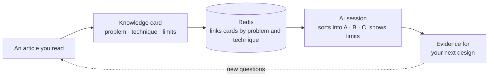
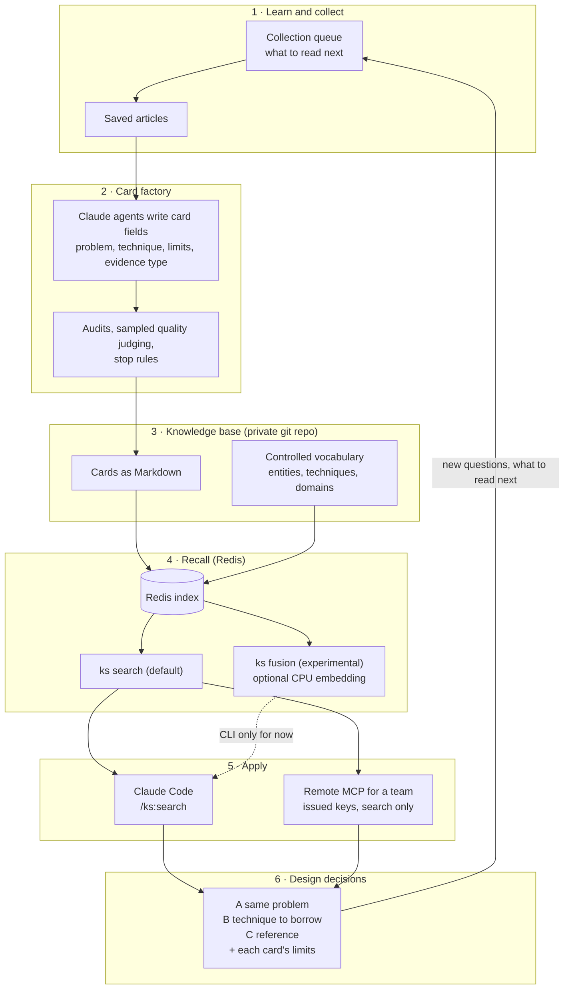
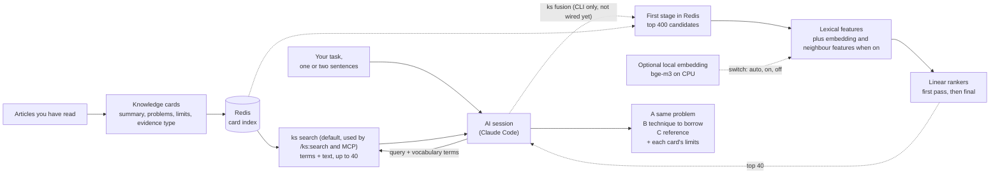

English | [한국어](README.ko.md)

# knowledge-scout

<!-- s:vision -->
> **Recall the technical articles you read and forgot, and use them as evidence in your next design.**

knowledge-scout is a knowledge search system for one person or a small team, built on Redis. The articles that matter most are often the ones you cannot recall when you start a design. knowledge-scout finds the articles you have already read that bear on the design in front of you, and hands them back as evidence.

The engine in this repository is public. Your cards and source articles stay in your own private repository. The project is a v0.2.0 release candidate that runs on macOS, and you can try it on a public sample of 17 cards in the [Quick start](#quick-start).

<!-- s:concept -->
## Concept and impact



Each article you read becomes one **knowledge card**, which records the problem the article tackles, the technique it uses, its limits, and the kind of evidence behind it. Describe a design task in a sentence or two, and Redis recalls the cards that share its problem or technique. Your AI session (Claude Code) sorts those cards into **A** same problem, **B** a technique to borrow, and **C** reference, and shows each card's limits next to it as evidence for your next design.

- **Precision@10 went from 0.298 to 0.796.** Precision@10 is the share of relevant cards in the top 10. The gain runs from the previous `ks search` engine to the experimental `ks fusion` ranker with its optional embedding switched on (it runs on CPU), measured in query-only search on the half of the queries kept for development. It is still just short of 0.80, the bar set for launch.
- **It runs on Redis and a CPU.** It uses no GPU and no vector database.
- **I use it every day.** It searches about 19,600 saved technical articles.

<!-- s:story -->
## Why I built this

I read a lot of technical articles. The ones that matter most slip my mind at the worst time, when I sit down to design the next system. I remember that I read something about the problem. I do not remember what it said or where I read it.

So I decided to register what I read as source material. I wanted a knowledge base that I could search by context and by the techniques that link articles, and that I could draw on when I design architectures and systems later.

To build it, I studied one Redis article and Ilyas Ibrahim's three-part series on Claude Code agents closely. None of them describes a knowledge search system. The idea came to me while I read about agents that lose their context. A model answers only from what is in its context window right now, and anything outside the window might as well not exist. Ilyas calls this "context amnesia". Forgetting what I read was the same problem.

I took six principles from these articles and built each one into the system:

| What I read | Source | What it became here |
| --- | --- | --- |
| Memory is an architecture requirement: move it out into a fast, shared store | Redis article | Cards live outside any session and are indexed in Redis |
| Redis is the memory layer, not the intelligence layer | Redis article | Redis recalls. The AI session judges A, B, C |
| Read a compact registry, not every report | Ilyas, part 2 | Search reads one-page cards, not full articles |
| Inject only the context that matters | Ilyas, part 2 | The session sees only the returned candidates (up to 40) |
| Do not trust a claim of "done". Check the output | Ilyas, part 2 | Card runs are audited and sample-judged. Search quality is measured |
| Write the standards into the workflow | Ilyas, part 3 | A fixed card schema and a controlled vocabulary |

My part was to move these principles from agents to the design work that a person and an AI do together, and to build them into a system that runs. Every article becomes a card with the same fields. A controlled vocabulary of entities, techniques, and domains links the cards. So an article about memory growth in a batch job can come up for a log-analysis task, because both use the same technique. Redis does the recall. The AI session makes the judgment, and it reads only the cards that come back.

**Inspired by** (I borrowed ideas, not code, and built the system myself):
- [Redis as Agent Memory: Building Stateful AI Agents with Redis and LangChain](https://medium.com/gitconnected/redis-as-agent-memory-building-stateful-ai-agents-with-redis-and-langchain-3dcd191a4fc2): moving agent memory out into a shared store, with Redis as the memory layer.
- Ilyas Ibrahim, [How I Made Claude Code Agents Coordinate 100% and Solved Context Amnesia](https://medium.com/@ilyas.ibrahim/how-i-made-claude-code-agents-coordinate-100-and-solved-context-amnesia-5938890ea825): context amnesia in practice. Agents kept redoing each other's work until a main agent with a shared registry coordinated them.
- Ilyas Ibrahim, [The 4-Step Protocol That Fixes Claude Code Agent's Context Amnesia](https://medium.com/@ilyas.ibrahim/the-4-step-protocol-that-fixes-claude-codes-context-amnesia-c3937385561c): registry, context injection, sequencing, and verification gates.
- Ilyas Ibrahim, [How to Build Production-Grade Systems with Claude Code without Context Drift](https://medium.com/@ilyas.ibrahim/how-to-build-production-grade-systems-with-claude-code-87f73dd311b9): review chains, and standards written into the workflow.

<!-- s:overview -->
## Architecture

The system is a loop of six stages. Saved articles pass through the card factory and become Markdown cards. Redis indexes the cards, and Claude Code or a remote MCP server for a team calls them up. Questions that come up during design go back into the collection queue.



<!-- s:achieved -->
## Results and where it stands

- I search a private corpus of about 19,600 saved technical articles every day. The cards behind the numbers below are not public. Three parts ship today: `ks search` (Redis, vocabulary terms and text, no model), the Claude Code plugin (`/ks:search`, `/ks:add`), and a search-only remote MCP server with API keys.
- The Rust ranker matches the JS reference on 100% of top-40 ids and scores, and 361 workspace tests pass (commit a7cb2ab, `scripts/ks-redis-test.sh`).

<!-- s:quality -->
### Search quality and how it was measured

Precision@10 is the share of the top 10 cards that the judge graded relevant: grade 1 ("partly useful") or 2 ("answers it") on a 0-2 scale. An unjudged card counts as not relevant, so the numbers are a lower bound. The numbers below are out-of-fold on the dev half, from the private search lab:

| Ranker | Query only | Query + terms |
| --- | --- | --- |
| Previous `ks search` engine | 0.298 | 0.568 |
| BM25 over character n-grams | 0.508 | 0.684 |
| bge-m3 embedding alone | 0.636 | 0.686 |
| `ks fusion`, CPU only (`--switch off`) | 0.744 | 0.794 |
| `ks fusion` + CPU embedding (`--switch on`) | 0.796 | 0.808 |
| Launch gate | 0.80 | 0.80 |

The embedding row is the live-embedding run at 0.796. With cached query vectors it scores 0.802 (see [docs/FUSION.md](docs/FUSION.md)). The shipped weights were fitted on the dev queries, so the table shows out-of-fold results on the dev half, not results on unseen data.

**Method.** A frozen snapshot of 5,607 cards. 100 real-use queries (80 Korean, 20 English), plus golden and new query sets. 40,907 (query, card) pairs graded by a Claude Sonnet judge, whose agreement with a Claude Opus judge is weighted kappa 0.903, measured on a 61-packet sample that Opus cross-judged. The queries are split into dev and test halves, and the test half is sealed. Out-of-fold means each query is scored by models fitted without it.

**Where it stands.** The gate is 0.80 in both modes. With the embedding, query + terms clears it (0.808) and query only falls just short (0.796). On CPU only, both modes are below it. The sealed test half has not been run, so these are dev numbers, not a final result. `ks fusion` runs only from the CLI and is not yet wired into `ks search` or `ks mcp serve`.

**Caveats.** The judge is an LLM. The lab set, the judgments and the trained weights are private, so this repository alone cannot reproduce the table. The numbers come from one corpus and one query mix. Latency is about 15 ms p50 on CPU only and about 190 ms p50 with a live CPU embedding in the lab harness ([docs/FUSION.md](docs/FUSION.md)). A single warm query on a quiet MacBook took about 50 ms. The Rust ranker matches the JS reference on all 112 dev query forms x 2 modes x 2 paths (top-40 ids and scores).

<!-- s:quickstart -->
## Try it

### Quick start

Try it first on the small public sample in `examples/sample-data` (17 cards, 10 golden queries). Start Redis, index the sample with `ks index rebuild --data examples/sample-data`, then search it with `ks search --data examples/sample-data --vocab examples/sample-data/vocab/terms.json --queries examples/sample-data/queries.json --out <out.json>`. To use your own cards:

1. Start Redis and install `ks` and the Claude Code plugin. Steps are in [docs/INSTALL.md](docs/INSTALL.md).
2. Put your cards in a private directory, then run `ks card validate --data <data>` and `ks index rebuild --data <data>`.
3. In Claude Code, run `/ks:search <your task>`. `/ks:add <URL or file>` turns one article into a card.

For the collection side, see [docs/OPERATIONS.md](docs/OPERATIONS.md).

<!-- s:demo -->
### Demo

`ks search` runs on the public sample described in the Quick start above. The `ks fusion` demo also needs the lab's model file and alias dictionary, which are not published, so read this section as a walkthrough.

```
cargo build --release
export KS_REDIS_URL=...    # the Redis ks uses; values are never printed
# 1. Build the fusion index (own prefix ksf:; plain ks keys are never touched)
ks fusion build --data <data dir> --aliases <aliases.json> --model <fusion-model.json> \
    --vectors <card-vectors.bin> --prefix ksf:
# 2. Search: --switch off is CPU only; auto uses a local bge-m3 server when it answers
ks fusion search --query "GitHub Actions에서 APK 빌드와 서명 자동화" --limit 3 \
    --switch auto --embed-url http://127.0.0.1:<port>
# Or: build, then 5 queries, each with --switch off and --switch auto
bash scripts/fusion-demo.sh <data dir> <aliases.json> <fusion-model.json> [<vectors.bin>] [<long summary dir>]
```

`<data dir>` is the data root that holds `cards/` and `vocab/`. The abridged output below uses illustrative numbers and made-up titles. If the server is down or too slow, the same call returns the CPU-only ranking with `"path": "off"` and `"reason": "embed-timeout"` (or `"embed-error"`).

```json
{ "switch": "auto", "path": "on", "reason": "embedded", "candidates": 400,
  "ms": { "embed": 33, "total": 52 },
  "results": [
    { "rank": 1, "title": "Signing Android release builds in CI without leaking the keystore" },
    { "rank": 2, "title": "Caching Gradle dependencies in GitHub Actions" },
    { "rank": 3, "title": "Automating Play Store uploads from a pipeline" } ] }
```

<!-- s:example -->
## Example

Task: "I want to find slow requests in web server logs and narrow down the cause." The cards below are made up.

| Card | Why it matched | Tier |
| --- | --- | --- |
| "Hard to narrow the cause of a slow request from logs alone" | Same problem as the task | A |
| "Memory keeps growing during a batch job" (technique: tracing by `request-id`) | Different problem, but the technique carries over | B |
| "Log storage cost grows quickly" | Same field (logs); neither problem nor technique overlaps | C |
| An article on screen-transition animations that happens to contain the word "slow" | Only a word matches | left out |

If card A says "assumes a single server", that sentence is shown as written, and you decide whether it fits your setup. A card's limits never move it up or down a tier.

<!-- s:diagram -->
## The search path in detail



<!-- s:how -->
## How the search works now

There are two rankers over the same cards.

| | `ks search` (default) | `ks fusion` (second ranker, demo level) |
| --- | --- | --- |
| Used by | `/ks:search`, `ks mcp serve` (stdio and remote) | the CLI only: `ks fusion build`, `search`, `batch` |
| Candidates | matched vocabulary terms and text in Redis, up to 40 | weighted full-text first stage in Redis, top 400 |
| Ranking | counts matches, judges nothing | 88 computed features, two linear rankers, top 40 |
| Embedding | none | optional, local, CPU |

How `ks fusion` works:

1. **Index**: `ks fusion build` writes each card as one Redis hash under its own key prefix (`ksf:`). The card's embedding vector is a FLOAT16 hash field, not a vector index. The card files are the source of truth, so the index can be rebuilt at any time.
2. **First stage**: one weighted `FT.SEARCH` returns the top 400 candidates.
3. **Features**: the schema has 142 columns, shared with the JS reference. This engine computes 88 of them and rejects a model that reads any other column. 83 are lexical: matches of query terms against the title, keywords, summary, problems and limits fields, plus coverage and n-grams. The other 5 need the embedding and exist only on that path: 3 compare the query with the card (cosine, its z-score, its reciprocal rank), and 2 are embedding-neighbour signals among the candidates.
4. **Rankers**: a first-pass linear ranker, then a final one. There is one set per path (embedding off or on) and per mode (query only, or query plus vocabulary terms). The trained weights file is not in this repository. Pass it with `--model`.
5. **Embedding switch**: `--switch auto|on|off`. The optional embedding comes from a bge-m3 model (FP16 GGUF) that you serve on your own machine with llama.cpp's `llama-server`, on CPU only, with no GPU. llama.cpp is used only to compute embeddings, never to generate text: ks sends the query to the server's OpenAI-style `POST /v1/embeddings` endpoint. With `auto`, the query is embedded while Redis answers, and without that server ks ranks on the CPU lexical path. If the server takes longer than 700 ms or fails, that query is ranked on the CPU path only and a 5 s circuit breaker opens. Ranking also skips the embedding when fewer than 80% of the candidates (or of the cards) have a vector (`few-vectors`, `no-vectors`). The JSON output records which `path` was used and why (`reason`).
6. **Judging**: the AI session reads only the returned cards, sorts them into A, B, C, or out, and shows each card's limits. Card text comes from outside articles, so it is treated as data, never as instructions.

<!-- s:fit -->
## Where it fits, and where it does not

It fits when:
- one person or a small team keeps hundreds to a few thousand articles and wants prior cases before starting work;
- you want to use it inside an AI coding tool such as Claude Code;
- you want to run it on Redis and a CPU, with no GPU and no separate search service (the embedding is optional).

Where it does not fit, or has limits:
- **An article without a card cannot be found.** Neither can a detail left out of a card.
- **The default engine misses different wording.** In our own evaluation of `ks search`, 47 of 59 expected cards (79.7%) were among the 40 candidates. That was 50 queries, a private evaluation set, one judge and one run, so the margin is large. The search terms were also chosen with the vocabulary list in view, and the real skill does not show that list, so the real-use figure is probably lower. It has not been measured. The optional embedding in `ks fusion` targets this gap (see the table above), measured on the lab set only.
- **Each search takes effort.** One measured run of the AI-session flow took 58 seconds and about $0.60 of model usage. It suits a few searches a day.
- Hundreds of thousands of articles, or searching raw text directly, call for embedding-based search (RAG). See "Is this RAG?" below.

<!-- s:rag -->
## Is this RAG?

Yes, in the broad sense: it searches first, then an AI reads what it found. It differs in two ways. It searches **cards**, not chunks of raw articles. And the default engine finds them by **tags and exact text matches** (keyword search). The optional `ks fusion` path adds a local CPU embedding as one group of ranking features. There is still no vector database: card vectors are plain Redis hash fields, not a vector index.

**Signs to move further toward RAG or a vector database** (thresholds are proposals, not measured):
- Rephrased queries score clearly lower, or fewer than 85% of expected cards reach the 40 candidates on fresh queries: use the embedding path (in the lab, it adds about 0.05 precision@10 in query-only mode).
- You need articles that have no card, or details missing from cards: search raw text chunks.
- Korean questions must find English articles directly: use multilingual embeddings (bge-m3 is one). Text matching cannot cross languages.
- A million vectors or more, or tens of queries per second: use a dedicated vector database.

**Backlog notice: `FT.HYBRID` (keyword plus vector hybrid search in one Redis query) is on the backlog and will be provided later.** Today knowledge-scout uses no vector index.

Evidence, the full table and the sources ([BEIR](https://arxiv.org/abs/2104.08663), [Anthropic Contextual Retrieval](https://www.anthropic.com/news/contextual-retrieval), [Redis `FT.HYBRID`](https://redis.io/docs/latest/commands/ft.hybrid/) and others) are in [docs/SEARCH-AND-RAG.md](docs/SEARCH-AND-RAG.md). Most are vendor tests or small studies. Read them as hints, and measure on your own queries.

<!-- s:remote -->
## Remote MCP (v0.2.0)

With a key you issue, someone else can search your cards from their own Claude Code. It uses the default `ks search` ranking. Fusion is not wired in yet.

- **Search only.** The remote server offers `ks_search` and `ks_get`. Web search, recording, collection, card creation, and indexing stay with the operator.
- **Keys.** The operator issues keys with `ks key issue`, and Redis stores only a hash of each key. Roles: `reader` sees public cards and a fixed list of fields, `admin` and `owner` see full cards.
- **Closed by default.** The server will not listen on a non-loopback address without a valid key, and it checks Host and Origin.
- **Connect.** Open an SSH tunnel, then add an HTTP MCP server at `http://127.0.0.1:8790/mcp` with `Authorization: Bearer <key>`.

Details: [docs/REMOTE-MCP.md](docs/REMOTE-MCP.md).

<!-- s:status -->
## Status

The v0.2.0 release candidate works on macOS, with Redis, the `ks` CLI, and the Claude Code plugin. On Linux the tests pass in CI, but real use is unverified. Windows is not supported. The collection queue, remote MCP over HTTP (search only, API keys), and the sample pool are in place. `ks export --scope team` is not. `ks fusion` is demo level (see "Results and where it stands"), and `FT.HYBRID` is on the backlog. See [CHANGELOG.md](CHANGELOG.md).

<!-- s:google -->
## Google browser collection notice

The `google-browser` engine automatically queries Google search results pages with the user's own logged-in profile. Such automated querying risks violating Google's terms, and the user is responsible for judging and accepting that risk. The defaults are low frequency (3 to 8 seconds between queries, a quota of 20 per hour and 100 per day per profile) and human intervention first (it stops when a CAPTCHA, consent prompt, or block appears). It does not evade detection.

Google's Terms of Service prohibit automated access that does not follow robots.txt, and google.com's robots.txt disallows `/search`. Using this engine may violate those terms, and if the violation is serious or repeated, Google may suspend the account. We recommend using a Google account dedicated to this purpose rather than your everyday account. The alternative that respects the terms is the official API adapter (planned).

<!-- s:docs -->
## Documentation map and license

- [docs/INSTALL.md](docs/INSTALL.md): Redis, `ks`, card directory, plugin, skills, Google login
- [docs/OPERATIONS.md](docs/OPERATIONS.md): collection queue, architecture diagram, browser search flow, components, data flow
- [docs/SEARCH-AND-RAG.md](docs/SEARCH-AND-RAG.md): search method, limits, when to move to RAG
- [docs/FUSION.md](docs/FUSION.md): the fusion ranker (`ks fusion`), with its commands, embedding switch, safety rules and measurements
- [docs/REMOTE-MCP.md](docs/REMOTE-MCP.md): remote MCP (v0.2.0)
- [SECURITY.md](SECURITY.md), [ARCHITECTURE.md](ARCHITECTURE.md), [CHANGELOG.md](CHANGELOG.md)

Licensed under Apache-2.0 ([LICENSE](LICENSE)). The origin of the borrowed code is recorded in [NOTICE](NOTICE).
