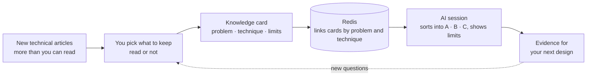
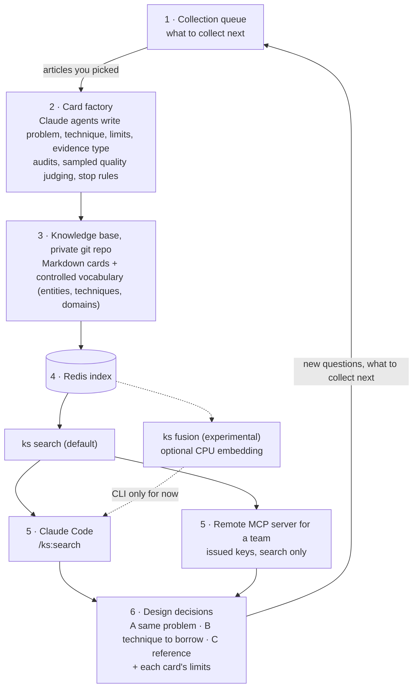

English | [한국어](README.ko.md)

# knowledge-scout

> **You can't read every technical article worth reading. Save the good ones, and find the right ones when you design.**

knowledge-scout is a knowledge search system for one person or a small team, built on Redis. Good technical articles come out faster than anyone can read them. Each article you pick to keep becomes a knowledge card, and the card is searchable whether or not you have read the article. When you start a design, knowledge-scout finds the cards that bear on it and hands them back as evidence.

The engine in this repository is public. Your knowledge cards and source articles stay private, in your own directories. Version 0.2.0 is released and runs on macOS. You can try it on a public sample of 17 cards in [Try it](#try-it).

<!-- s:concept -->
## Concept and impact


Each article you pick becomes one **knowledge card**, which records the problem the article tackles, the technique it uses, its limits, and the kind of evidence behind it. A **controlled vocabulary** of entities, techniques, and domains tags every card. Describe a design task in a sentence or two. Your AI session (Claude Code) turns it into vocabulary terms and short problem phrases, and Redis recalls the cards that share them. The AI session then sorts those cards into **A** same problem, **B** a technique to borrow, and **C** reference, and shows each card's limits next to it as evidence for your next design.

- **Precision@10 went from 0.298 to 0.796 in my private search lab.** Precision@10 is the share of relevant cards in the top 10. The gain runs from `ks search`, the default engine, to the experimental `ks fusion` ranker with its optional CPU embedding switched on. Both were measured in query-only search on the half of the queries kept for development. 0.796 is still just short of 0.80, the bar set for launch.
- **It runs on Redis and a CPU.** It uses no GPU and no vector database.
- **I use it every day**, on the cards of my private collection of about 19,600 saved technical articles. I have not read them all.

<!-- s:why -->
## Why I built this
Good technical articles pour out every day. I pick the ones worth reading and save them, but I save them faster than I can read them. When I sit down to design the next system, the article that would help may be in that pile. If I never read it, I cannot remember it.

So I decided to register what I pick as source material, whether I have read it or not. Each article becomes a card in a knowledge base that I can search by context and by the techniques that link articles. I draw on it when I design architectures and systems.

To build it, I studied one Redis article and Ilyas Ibrahim's three-part series on Claude Code agents closely. None of them describes a knowledge search system. The idea came to me while I read about agents that lose their context. A model answers only from what is in its context window right now, and anything outside the window might as well not exist. Ilyas calls this "context amnesia". Their answer is to keep context in an external, structured store and recall only what is relevant. My unread backlog had the same shape. An article I saved but never read is not in my head, but in a structured store it can still come back when a design needs it. I took six principles from these articles and built each one into the system:

| Principle | Source | What it became here |
| --- | --- | --- |
| Memory is an architecture requirement: move it out into a fast, shared store | Redis article | Cards live outside any session and are indexed in Redis |
| Redis is the memory layer, not the intelligence layer | Redis article | Redis recalls. The AI session judges A, B, C |
| Read a compact registry, not every report | Ilyas, part 2 | Search reads one-page cards, not full articles |
| Inject only the context that matters | Ilyas, part 2 | The AI session sees only the returned candidates (up to 40) |
| Do not trust a claim of "done". Check the output | Ilyas, part 2 | Card runs are audited and sample-judged. Search quality is measured |
| Write the standards into the workflow | Ilyas, part 3 | A fixed card schema and a controlled vocabulary |

My part was to move these principles from agents to the design work that a person and an AI do together, to point them at the articles I saved but have not read, and to build them into a system that runs. Every article becomes a card with the same fields. The controlled vocabulary links the cards. So an article about memory growth in a batch job can come up for a log-analysis task, because both use the same technique, even if I never read it. Redis does the recall. The AI session makes the judgment, and it reads only the cards that come back.

**Inspired by** (I borrowed ideas, not code, and built the system myself):
- [Redis as Agent Memory: Building Stateful AI Agents with Redis and LangChain](https://medium.com/gitconnected/redis-as-agent-memory-building-stateful-ai-agents-with-redis-and-langchain-3dcd191a4fc2): moving agent memory out into a shared store, with Redis as the memory layer.
- Ilyas Ibrahim, [How I Made Claude Code Agents Coordinate 100% and Solved Context Amnesia](https://medium.com/@ilyas.ibrahim/how-i-made-claude-code-agents-coordinate-100-and-solved-context-amnesia-5938890ea825): context amnesia in practice. Agents kept redoing each other's work until a main agent with a shared registry coordinated them.
- Ilyas Ibrahim, [The 4-Step Protocol That Fixes Claude Code Agent's Context Amnesia](https://medium.com/@ilyas.ibrahim/the-4-step-protocol-that-fixes-claude-codes-context-amnesia-c3937385561c): registry, context injection, sequencing, and verification gates.
- Ilyas Ibrahim, [How to Build Production-Grade Systems with Claude Code without Context Drift](https://medium.com/@ilyas.ibrahim/how-to-build-production-grade-systems-with-claude-code-87f73dd311b9): review chains, and standards written into the workflow.

<!-- s:diagram -->
## Architecture
The system is a loop of six stages. The articles you pick pass through the card factory and become Markdown cards. Redis indexes the cards, and Claude Code or the remote MCP server for a team calls them up. Questions that come up during design go back into the collection queue. The first two stages run partly outside this repository: `ks research search --queue` writes the queue, a collector you run yourself fetches the articles, and `ks card import` loads the card factory's output. `/ks:add` writes one card at a time.



<!-- s:status -->
## Results and where it stands
Version 0.2.0 ships `ks search` (Redis matches vocabulary terms and text, no model), the Claude Code plugin (`/ks:search`, `/ks:add`, `/ks:research`), a search-only remote MCP server with API keys, the collection queue, and the public sample. It runs on macOS with Redis 8. On Linux its tests pass in CI, but real use is unverified. Windows is not supported. `ks fusion` is experimental and not in a release. `ks export --scope team` and `FT.HYBRID` are on the backlog. See [CHANGELOG.md](CHANGELOG.md).

### Search quality and how it was measured
All numbers in this section come from my private search lab. Precision@10 is the share of the top 10 cards that the judge graded relevant: grade 1 ("partly useful") or 2 ("answers it") on a 0-2 scale. An unjudged card counts as not relevant, so the numbers are a lower bound. They are out-of-fold on the dev half, against a launch gate of 0.80 in both modes:

| Ranker | Query only | Query + terms |
| --- | --- | --- |
| `ks search` (default engine) | 0.298 | 0.568 |
| BM25 over character n-grams | 0.508 | 0.684 |
| bge-m3 embedding alone | 0.636 | 0.686 |
| `ks fusion`, CPU only (`--switch off`) | 0.744 | 0.794 |
| `ks fusion` + CPU embedding (`--switch on`) | 0.796 | 0.808 |

**Method.** A frozen snapshot of 5,607 cards. 100 real-use queries (80 Korean, 20 English), plus golden and new query sets. A Claude Sonnet judge graded 40,907 (query, card) pairs. Its agreement with a Claude Opus judge is weighted kappa 0.903, measured on a 61-packet sample that Opus cross-judged. The queries are split into dev and test halves, and the test half is sealed. Out-of-fold means each query is scored by models fitted without it. The shipped weights were fitted on the dev queries, so these are not results on unseen data.

**Where it stands.** With the embedding, query + terms clears the gate (0.808) and query only falls just short (0.796). On CPU only, both modes are below it. The sealed test half has not been run, so these are dev numbers, not a final result.

**Caveats.** The judge is an LLM. The lab set, the judgments, and the trained weights are private, so this repository alone cannot reproduce the table. The numbers come from one corpus and one query mix. The embedding row is the live-embedding run. With cached query vectors, query only scores 0.802. In the lab harness, a query takes about 15 ms p50 on CPU only and about 190 ms p50 with a live CPU embedding. The Rust `ks fusion` returns the same top 40 ids and scores as the lab's JS reference on all 112 dev query forms, in both modes and on both paths. The 361 workspace tests passed at the commit that added it (a7cb2ab). [docs/FUSION.md](docs/FUSION.md) has the measurements this repository can show.

<!-- s:quickstart -->
## Try it
Try `ks search` on the public sample in `examples/sample-data` (17 cards, 10 golden queries). Start Redis and install `ks` as described in [docs/INSTALL.md](docs/INSTALL.md). Use a Redis that holds no index of yours, because a rebuild replaces the index ([docs/servers.md](docs/servers.md) runs a separate one). With the Redis settings from INSTALL in the environment, run:

```
ks index rebuild --data examples/sample-data
ks search --data examples/sample-data --vocab examples/sample-data/vocab/terms.json \
    --queries examples/sample-data/queries.json --out results.json
```

To use your own cards, put them in a private data directory, run `ks card validate --data <data>` and `ks index rebuild --data <data>`, and install the Claude Code plugin. Then run `/ks:search <your task>` in Claude Code. `/ks:add <URL, file, or text>` turns one article into a card. The `ks fusion` demo needs a model file and an alias dictionary from the private search lab, so read [its demo](docs/FUSION.md#demo) as a walkthrough.

<!-- s:how -->
## How a search works
`/ks:search` and the remote MCP server both search with `ks search`, through the `ks_search` tool of `ks mcp serve`:
1. **Interpret.** The AI session turns your task into controlled-vocabulary terms and short problem phrases (at most 32 terms of 64 characters each, and the task itself in up to 512 characters).
2. **Recall.** Redis fetches the cards that carry a matching vocabulary term or contain a term in their title, summary, problems, limits, or reusable elements. Terms the vocabulary does not know come back as `unknown_terms` and match only as text.
3. **Rank.** `ks` orders the cards by the number of matched vocabulary terms, then text matches, then the rarest matched term, and returns the top 40. It counts matches and judges nothing. If the cards or the vocabulary changed after the last `ks index rebuild`, it refuses to search and prints the rebuild command.
4. **Judge.** The AI session reads only the returned cards, sorts each into A, B, or C or leaves it out, and quotes the card as evidence. A card's limits are shown as written. Card text comes from outside articles, so it is treated as data, never as instructions.

`ks fusion` is an experimental second ranker that replaces steps 2 and 3. It runs from the CLI only (`ks fusion build`, `search`, `batch`) and is not wired into `/ks:search` or `ks mcp serve`. It indexes each card as one Redis hash under its own key prefix (`ksf:`), takes the top 400 candidates from one weighted `FT.SEARCH`, and ranks them with a first-pass and a final linear ranker into the top 40. The weights come from a model file that the private search lab writes (`--model`). The rankers read 88 features, the columns this engine computes out of the 142 it shares with the JS reference. It refuses a model that reads any other column. 83 features come from text matching. 5 need the embedding: query-card cosine, its z-score, and its reciprocal rank, plus 2 signals from each card's embedding neighbours among the candidates.

The embedding is optional. It comes from a bge-m3 model that you serve on your own machine with llama.cpp's `llama-server`, on CPU only. `ks` accepts only a loopback URL, sends the query to the server's `POST /v1/embeddings` endpoint, and never uses it to generate text. Card vectors are FLOAT16 fields in the card hashes, not a vector index. `--switch auto|on|off` decides per query whether the embedding is used. With `auto`, the default, the query is embedded while Redis answers. If the server fails or takes longer than 700 ms, that query is ranked without the embedding, and a circuit breaker stops further calls for 5 s. `auto` also skips the embedding when fewer than 80% of the cards, or of a query's candidates, have a vector. The JSON output records the `path` each query took and the `reason`. Commands, safety rules, and measurements are in [docs/FUSION.md](docs/FUSION.md).

<!-- s:example -->
## Example
Task: "I want to find slow requests in web server logs and narrow down the cause." The cards below are made up. The search reads only the cards, so it makes no difference whether you have read the articles behind them.

| Card | Why it matched | Tier |
| --- | --- | --- |
| "Hard to narrow the cause of a slow request from logs alone" | Same problem as the task | A |
| "Memory keeps growing during a batch job" (technique: tracing by `request-id`) | Different problem, but the technique carries over | B |
| "Log storage cost grows quickly" | Same field (logs); neither problem nor technique overlaps | C |
| An article on screen-transition animations that happens to contain the word "slow" | Only a word matches | left out |

If card A says "assumes a single server", that sentence is shown as written, and you decide whether it fits your setup. A card's limits never move it up or down a tier.

<!-- s:remote -->
## Remote MCP (v0.2.0)
With a key you issue, someone else can search your cards from their own Claude Code. The remote MCP server ranks with `ks search`, and `ks fusion` is not wired in. Details are in [docs/REMOTE-MCP.md](docs/REMOTE-MCP.md).
- **Search only.** It offers `ks_search` and `ks_get`. Web search, application records, collection, card creation, and indexing stay with the operator.
- **Keys and roles.** `ks key issue` prints a key once, and Redis keeps only its SHA-256 and metadata. A `reader` sees only `scope: public` cards and a fixed list of fields. `admin` and `owner` see full cards.
- **Closed by default.** On a non-loopback address the server refuses to start unless an active key exists. `--no-auth` works only on loopback, and readers are refused if any card is not public. Every request is checked for its key, Host, and Origin. There is no TLS, so connect through an SSH tunnel, for example to `http://127.0.0.1:8790/mcp` with `Authorization: Bearer <key>`.

<!-- s:fit -->
## Where it fits, and where it does not
It fits when one person or a small team saves more articles than they can read, turns them into hundreds to a few thousand cards, and wants prior cases from them before starting work. It runs inside an AI coding tool such as Claude Code, on Redis and a CPU with no GPU and no separate search service. It does not fit, or has limits, here:
- **An article without a card cannot be found.** Neither can a detail left out of a card. For an article you have not read, the card is all that you and the search have.
- **`ks search` misses different wording.** In my own evaluation, 47 of 59 expected cards (79.7%) were among the 40 candidates. That was 50 queries, a private evaluation set, one judge, and one run, so the margin is large. The search terms were chosen with the vocabulary list in view, and `/ks:search` does not show that list, so real use is probably lower. It has not been measured. The optional embedding in `ks fusion` targets this gap, measured on the lab set only.
- **Each search takes effort.** One measured run of `/ks:search` took 58 seconds and about $0.60 of model usage. It suits a few searches a day.

<!-- s:rag -->
## Is this RAG?
Yes, in the broad sense: it searches first, then an AI reads what it found. It differs in two ways. It searches **cards**, not chunks of raw articles. And `ks search` finds them by **tags and exact text matches** (keyword search). `ks fusion` can add a local CPU embedding as one group of ranking features, but there is still no vector database or vector index. Signs to move further toward RAG or a vector database (the thresholds are proposals, not measurements):
- Fewer than 85% of expected cards reach the 40 candidates on fresh queries, or rephrased queries score clearly lower: use embeddings. In the lab, the `ks fusion` embedding adds about 0.05 precision@10 in query-only mode.
- You need articles that have no card, or details missing from cards: search raw text chunks.
- Korean questions must find English articles directly: use multilingual embeddings such as bge-m3. Text matching cannot cross languages.
- A million vectors or more, or tens of queries per second: an HNSW index in Redis first, then a dedicated vector database.

**Backlog notice: `FT.HYBRID` (keyword plus vector hybrid search in one Redis query) is on the backlog and will be provided later.** The evidence and sources ([BEIR](https://arxiv.org/abs/2104.08663), [Anthropic Contextual Retrieval](https://www.anthropic.com/news/contextual-retrieval), [Redis `FT.HYBRID`](https://redis.io/docs/latest/commands/ft.hybrid/), and others) are in [docs/SEARCH-AND-RAG.md](docs/SEARCH-AND-RAG.md). Most are vendor tests or small studies. Read them as hints, and measure on your own queries.

<!-- s:google -->
## Google browser collection notice
The `google-browser` engine behind `/ks:research` automatically queries Google search results pages with the user's own logged-in profile. Such automated querying risks violating Google's terms, and the user is responsible for judging and accepting that risk. The defaults are low frequency (3 to 8 seconds between queries, a quota of 20 per hour and 100 per day per profile) and human intervention first (it stops when a CAPTCHA, consent prompt, or block appears). It does not evade detection.

Google's Terms of Service prohibit automated access that does not follow robots.txt, and google.com's robots.txt disallows `/search`. Using this engine may violate those terms, and if the violation is serious or repeated, Google may suspend the account. Use a Google account dedicated to this purpose rather than your everyday account. The alternative that respects the terms is the official API adapter (planned).

<!-- s:docs -->
## Documentation map and license
[docs/INSTALL.md](docs/INSTALL.md) covers Redis, `ks`, the card directory, the plugin, the skills, and Google login. [docs/OPERATIONS.md](docs/OPERATIONS.md) covers the collection queue, the browser search flow, and the components. [docs/SEARCH-AND-RAG.md](docs/SEARCH-AND-RAG.md) covers the search method, its limits, and when to move to RAG. [docs/FUSION.md](docs/FUSION.md) covers `ks fusion`, and [docs/REMOTE-MCP.md](docs/REMOTE-MCP.md) covers the remote MCP server (v0.2.0). See also [SECURITY.md](SECURITY.md), [ARCHITECTURE.md](ARCHITECTURE.md), and [CHANGELOG.md](CHANGELOG.md). Licensed under Apache-2.0 ([LICENSE](LICENSE)). The origin of the borrowed code is recorded in [NOTICE](NOTICE).
