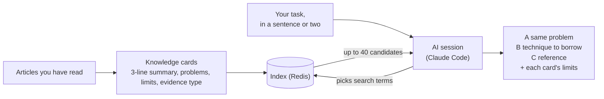

English | [한국어](README.ko.md)

# knowledge-scout

A tool that lets you reuse the technical articles you have already read, when you start new work.

You remember reading an article about a problem like this one, but finding it again is hard. knowledge-scout shrinks each article into a one-page **knowledge card**. You describe the task you are about to do in a sentence or two, and it picks the matching cards. **A** is an article on the same problem, **B** is one whose technique you can borrow, **C** is for reference. Every card shows its own **limits** next to it.

The engine (this repository) is public. The cards and the source articles stay in your own private repository. The judging is done by the AI session you already use, such as Claude Code.

<!-- s:example -->
## Example

Task: "I want to find slow requests in web server logs and narrow down the cause". The cards below are made up.

| Card | Why it matched | Tier |
| --- | --- | --- |
| "Hard to narrow the cause of a slow request from logs alone" | Same problem as the task | A |
| "Memory keeps growing during a batch job" (technique: tracing by `request-id`) | Different problem, but the technique carries over | B |
| "Log storage cost grows quickly" | Same field (logs); neither problem nor technique overlaps | C |
| An article on screen-transition animations that happens to say "slow" | Only a word matches | left out |

If card A says "assumes a single server", that sentence is shown as written, and you decide whether your setup fits. A card never moves up or down a tier because of its limits.

<!-- s:diagram -->
## The picture

<!-- s:why -->
## Why use it

- An article you only saved is not found when you need it.
- An ordinary search gives "similar articles". It does not say whether one fits your task.
- Evidence differs by article. You should see whether it is a measurement, an experience report, or an opinion.

<!-- s:fit -->
## Where it fits, and where it does not

It fits when:
- one person or a small team keeps hundreds to a few thousand articles and wants prior cases before starting work;
- you want to use it inside an AI coding tool such as Claude Code;
- you want to run it without an embedding model or a separate search service.

It does not fit, or is limited, when:
- **An article that has no card cannot be found.** A detail left out of a card cannot be found either.
- **Different wording is missed.** In our own evaluation, 47 of 59 expected cards (79.7%) were among the 40 candidates. The conditions: 50 queries, a private evaluation set, one judge, one run, so the margin is large. The search terms were chosen with the vocabulary list in view; the real skill does not show it, so real use is probably lower and has not been measured.
- **A search takes effort.** One measured run took 58 seconds and about $0.60 of model usage. It suits a few searches a day.
- Hundreds of thousands of articles, or searching raw text directly, is a job for embedding-based search (RAG). See "Is this RAG?" below.

<!-- s:quickstart -->
## Quick start

Try it on a small public sample card set (v0.2.0; not published yet). To use your own cards today:

1. Start Redis and install `ks` and the Claude Code plugin. Steps are in [docs/INSTALL.md](docs/INSTALL.md).
2. Put your cards in a private directory, then run `ks card validate --data <data>` and `ks index rebuild --data <data>`.
3. In Claude Code, run `/ks:search <your task>`. `/ks:add <URL or file>` turns one article into a card.

To feed the collection side, see [docs/OPERATIONS.md](docs/OPERATIONS.md).

<!-- s:how -->
## How it works

1. **Card**: one article becomes one Markdown file (summary, problems, limits, evidence type, tags from a controlled vocabulary).
2. **Index**: `ks index rebuild` loads all cards into Redis. The cards are the source of truth, so the index can be rebuilt at any time.
3. **Query**: the AI session turns your task into vocabulary terms and a short problem phrase.
4. **Candidates**: the engine ranks cards by matched terms and text, and returns up to 40. It counts; it does not judge.
5. **Judging**: the session reads only the cards and sorts them into A, B, C, or out, showing each card's limits. Card text comes from outside articles, so it is handled as data, never as instructions.

<!-- s:rag -->
## Is this RAG?

Yes in the broad sense: it searches first, then an AI reads the result. It differs in two ways. It searches **cards**, not chunks of raw articles. And it finds them by **tags and exact text matches** (keyword search), with no embeddings and no vector database.

**When it works well:** hundreds to thousands of cards, queries that contain technical names, results that must explain why they matched, and no wish to run a model on the server.

**Signs to move to RAG or a vector database** (thresholds are proposals, not measured):
- Rephrased queries score clearly lower, or fewer than 85% of expected cards reach the 40 candidates on fresh queries: embed the card text, in the same Redis.
- You must find articles that have no card, or details missing from cards: search raw text chunks.
- Korean questions must find English articles directly: multilingual embeddings. Text matching cannot cross languages.
- A million vectors or more, or tens of queries per second: a dedicated vector database.

**Backlog notice: `FT.HYBRID` (keyword plus vector hybrid search in one Redis query) is on the backlog and will be provided later.** Today knowledge-scout uses no vector search.

Evidence and the full table are in [docs/SEARCH-AND-RAG.md](docs/SEARCH-AND-RAG.md). Main sources:
[BEIR](https://arxiv.org/abs/2104.08663),
[Anthropic Contextual Retrieval](https://www.anthropic.com/news/contextual-retrieval),
[Li et al. 2024](https://arxiv.org/abs/2407.16833),
[LaRA](https://arxiv.org/abs/2502.09977),
[Redis vectors](https://redis.io/docs/latest/develop/ai/search-and-query/vectors/),
[Redis `FT.HYBRID`](https://redis.io/docs/latest/commands/ft.hybrid/),
[Redis stemming](https://redis.io/docs/latest/develop/ai/search-and-query/advanced-concepts/stemming/).
Most are vendor tests or small studies; read them as hints, and measure on your own queries.

<!-- s:remote -->
## Remote MCP (v0.2.0)

Planned for v0.2.0 and not implemented yet. It lets someone search your cards from their own Claude Code with a key you issue.

- **Search only.** The remote server offers `ks_search` and `ks_get`. Web search, recording, collection, card creation, and indexing stay with the operator.
- **Keys.** The operator issues keys with `ks key create`; Redis stores only a hash of each. Roles: `reader` sees public cards and a fixed list of fields, `admin` and `owner` see full cards.
- **Closed by default.** The server will not listen on a non-loopback address without a valid key, and it checks Host and Origin.
- **Connect.** Open an SSH tunnel, then add an HTTP MCP server at `http://127.0.0.1:8790/mcp` with `Authorization: Bearer <key>`.

Details: [docs/REMOTE-MCP.md](docs/REMOTE-MCP.md).

<!-- s:status -->
## Status

Version 0.1.0 works on macOS, with Redis, the `ks` CLI, and the Claude Code plugin. On Linux the tests pass in CI, but real use is unverified; Windows is not supported. The collection queue is in place; remote MCP, the sample pool, and `ks export --scope team` are not. See [CHANGELOG.md](CHANGELOG.md).

<!-- s:google -->
## Google browser collection notice

The `google-browser` engine automatically queries Google search results pages with the user's own logged-in profile. Such automated querying risks violating Google's terms, and the user is responsible for judging and accepting that risk. The defaults are low frequency (3 to 8 seconds between queries, a quota of 20 per hour and 100 per day per profile) and human intervention first (it stops when a CAPTCHA, consent prompt, or block appears). It does not evade detection.

Google's Terms of Service prohibit automated access that does not follow robots.txt, and google.com's robots.txt disallows `/search`. Using this engine may violate those terms, and if the violation is serious or repeated, Google may suspend the account. We recommend using a Google account dedicated to this purpose rather than your everyday account. The alternative that respects the terms is the official API adapter (planned).

<!-- s:docs -->
## Documentation map and license

- [docs/INSTALL.md](docs/INSTALL.md): Redis, `ks`, card directory, plugin, skills, Google login
- [docs/OPERATIONS.md](docs/OPERATIONS.md): collection queue, architecture diagram, browser search flow, components, data flow
- [docs/SEARCH-AND-RAG.md](docs/SEARCH-AND-RAG.md): search method, limits, when to move to RAG
- [docs/REMOTE-MCP.md](docs/REMOTE-MCP.md): remote MCP (v0.2.0)
- [SECURITY.md](SECURITY.md), [ARCHITECTURE.md](ARCHITECTURE.md), [CHANGELOG.md](CHANGELOG.md)

Apache-2.0 ([LICENSE](LICENSE)). The origin of the borrowed code is recorded in [NOTICE](NOTICE).
